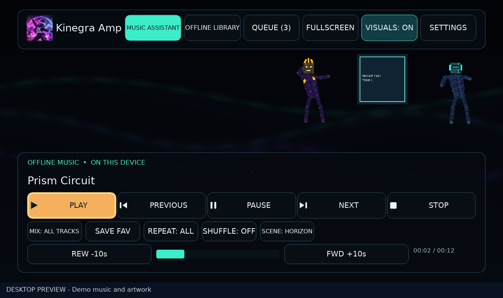

# Kinegra Amp


**Music and visuals for NVIDIA SHIELD.**

Play music from Music Assistant or your own files, build a queue with your TV remote, and switch between album artwork, neon scenes and dancing avatars. Music Assistant playback stays inside Amp.



## Install

**[Download 1.0.16 public beta](https://github.com/matthewhand/kinegra-amp/releases/tag/v1.0.16)** · Android 8.0+ · ARM64

Sideload `KinegraAmp-1.0.16.apk` onto your SHIELD, or install with ADB:

```sh
adb connect DEVICE_IP:ADB_PORT
adb install -r KinegraAmp-1.0.16.apk
```

## Play music

Amp is built around [Music Assistant](https://github.com/music-assistant/server), with local MP3/Ogg playback also supported.

1. Open **Music Assistant → Settings**, enter your server address and library access token, then **Connect library**. Enable **Remember access** to save the connection.
2. Browse or search **Albums**, **Tracks** or **Playlists**, choose your music and press **Play**. Approve playback pairing in Music Assistant when prompted.
3. Use **Add to Queue** without interrupting playback, **Queue Page** to add the displayed tracks, or **View Queue** to see what is next.

Navigate with the remote’s D-pad and OK, or the controller’s D-pad and A. Back/B closes dialogs or exits fullscreen. [Library and queue controls](docs/MA-LIBRARY-REMOTE.md).

For local music, open **Offline Library → Import from USB / Internal Storage** and choose MP3/Ogg files. **Delete Copy** removes an imported copy from Amp. No music is bundled. [Offline library](docs/OFFLINE-LIBRARY.md).

## Make it yours

- **Visuals On / Off**, **Scene** and **Fullscreen** switch between artwork and animated scenes. [Artwork and visuals](docs/ARTWORK-AND-FULLSCREEN.md).
- **Webcam avatars** use a separately configured Kinegra Cam pose feed. [Webcam setup](docs/WEBCAM-GESTURES.md).
- **Web remote** adds browser playback, library and queue controls. Enable it in Settings; it starts off by default. [Web remote and API](docs/WEB-REMOTE.md) · [CLI](docs/CLI.md).

## Beta notes

Tested on an original NVIDIA SHIELD with SHIELD Experience 9.x (Android 11), an ultrawide display and one Razer USB webcam. Other hardware and long-session coverage is limited.

Webcam tracking and gestures remain experimental. **Bulk offline queue copying is also experimental:** Amp retries temporary errors, and Resume Saving picks up interrupted copies. [Offline copying](docs/OFFLINE-COPYING.md) · [Compatibility and testing](docs/VALIDATION.md).

[Build from source](docs/BUILDING.md) · [Contribute](docs/DEVELOPMENT.md) · [Privacy](docs/PRIVACY.md) · [Demo details](docs/DEMO.md)

## License

[MIT](LICENSE) covers original code, documentation, artwork and hero media. Dependencies retain their own terms; see [third-party notices](docs/THIRD-PARTY-NOTICES.md).
