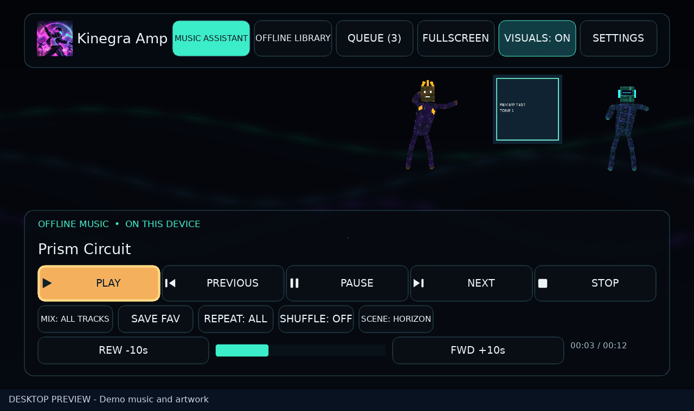

# Kinegra Amp

Kinegra Amp is a music player and visualiser for NVIDIA SHIELD. Play your own MP3 or Ogg files without a server, or connect your Music Assistant library. Use the TV remote to play music, manage the queue and switch between artwork and animated scenes.

**[Download the 1.0.19 beta APK](https://github.com/matthewhand/kinegra-amp/releases/download/v1.0.19/KinegraAmp-1.0.19.apk)** · Android 8.0+ · ARM64

[Install or update](docs/UPGRADING.md) · [Release notes and checksums](https://github.com/matthewhand/kinegra-amp/releases/tag/v1.0.19)

## Start playing

### Play local files

Open **Offline Library → Import from USB / Internal Storage**, choose your MP3 or Ogg files, then select a track and choose **Play**. Amp starts with an empty library. Imports are copied into Amp. [Offline library guide](docs/OFFLINE-LIBRARY.md)

### Connect Music Assistant

1. With your [Music Assistant server](https://github.com/music-assistant/server) already running, open **Music Assistant → Settings**. Enter the server address and library access token, then select **Connect library**. Enable **Remember access** to save the connection.
2. Browse or search **Albums**, **Tracks** or **Playlists**, choose your music and press **Play**. Approve playback pairing in Music Assistant when prompted.
3. Use **Add to Queue** to add a selection, **Queue Page** to add the displayed tracks, or **View Queue** to see what is next. Playback stays inside Amp.

Use the remote’s D-pad and OK, or a controller’s D-pad and A. Back/B closes dialogs or exits fullscreen. [Library and queue controls](docs/MA-LIBRARY-REMOTE.md)

## Volume and background playback

**Settings** opens with **App Volume** selected. Press Left or Right to change Amp’s level. Amp remembers the setting. In [Kinegra Home Split View](https://github.com/matthewhand/kinegra-home), use App Volume to balance Amp against the other pane. The TV volume changes the combined output.

**Keep playing in background** is on by default for Music Assistant and local files. Music continues through Android Home and return. Turn the setting off to pause when you leave. Playback stays paused when you return until you press Play. Use **Save Setup** to remember this choice after restarting Amp.

## See the player

This still comes from a Godot/Linux desktop demo made with synthetic music, artwork and track names. The sequence shows local playback, a three-track queue and fullscreen artwork with procedural dancers. [Watch the silent 16-second demo (GIF, about 3 MB)](docs/readme/kinegra-amp-hero.gif) · [How the demo was made](docs/DEMO.md)

## Optional features

- **Visuals On / Off**, **Scene** and **Fullscreen** switch between artwork and animated scenes. [Artwork and visuals](docs/ARTWORK-AND-FULLSCREEN.md)
- **Webcam avatars** and experimental gestures use a separately configured Kinegra Cam pose feed. [Webcam setup](docs/WEBCAM-GESTURES.md)
- **Web remote** and **CLI** can browse the library and control playback. The web remote is off by default and requires its access key by default when enabled. [Web remote and API](docs/WEB-REMOTE.md) · [CLI](docs/CLI.md)

## Beta notes

Device testing has covered an original NVIDIA SHIELD with SHIELD Experience 9.x (Android 11), an ultrawide display and one Razer USB webcam. Other hardware and long sessions have limited coverage. [Compatibility and testing](docs/VALIDATION.md)

**Save Queue Offline** is experimental and uses a separate file-source helper for your own local-file queues. Amp retries temporary errors. With an older helper, resuming restarts the interrupted track and retains completed files. [Offline copying](docs/OFFLINE-COPYING.md)

[Build from source](docs/BUILDING.md) · [Contribute](docs/DEVELOPMENT.md) · [Privacy](docs/PRIVACY.md)

## License

[MIT](LICENSE) covers original code, documentation, artwork and hero media. Dependencies retain their own terms; see [third-party notices](docs/THIRD-PARTY-NOTICES.md).
